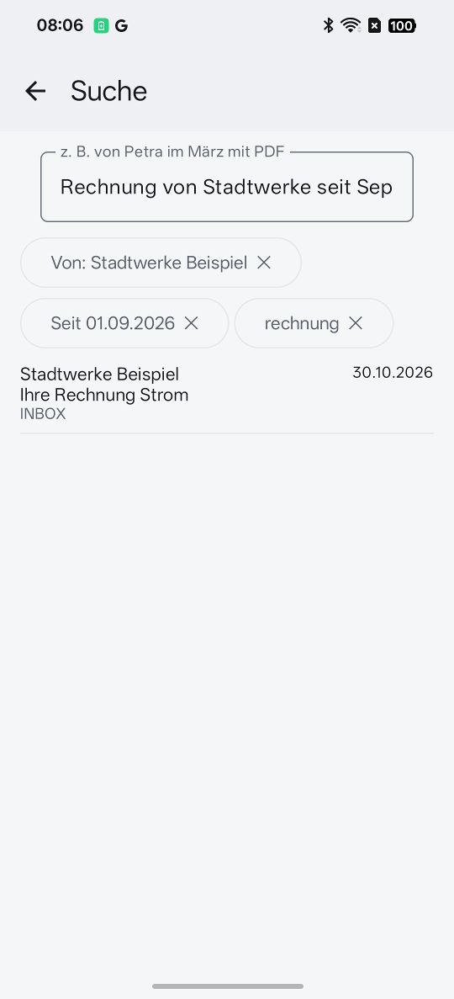
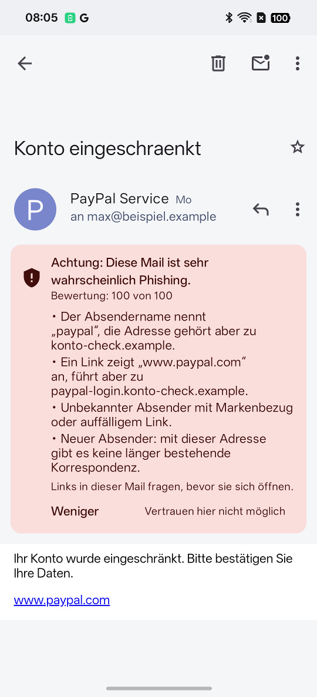
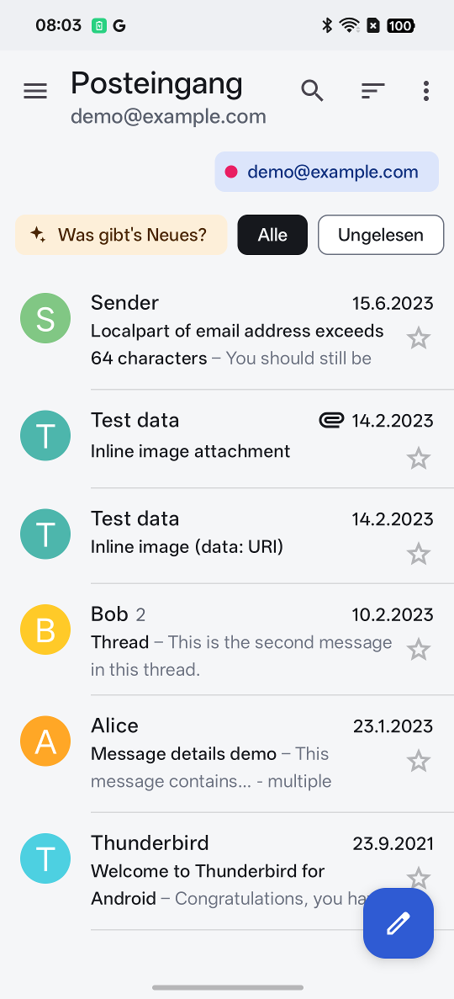
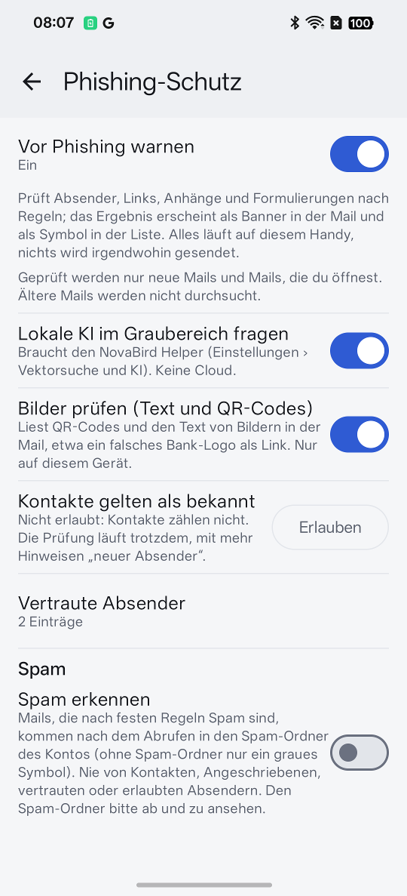
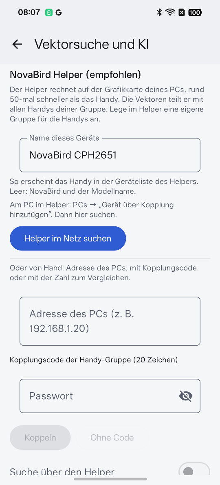
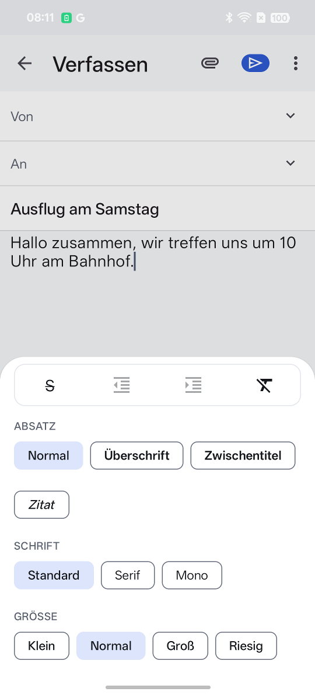

# NovaBird Mail for Android

NovaBird Mail is a fork of [Thunderbird for Android](https://github.com/thunderbird/thunderbird-android)
(based on Thunderbird 25.0b2). It brings the features of the NovaBird add-on for Thunderbird on the desktop to the
phone and adds a few things to Thunderbird that we missed in everyday use.

Search, phishing protection and the AI texts use the same core as the desktop add-on. Heavy work can be handed to the
**NovaBird Helper** on your PC: vectors for the search, summaries and reading aloud. Everything stays in your own
network; no cloud is involved.

> **Beta.** NovaBird Mail is still in development. It runs on Android 14 and newer (64-bit).

<table>
  <tr>
    <td></td>
    <td></td>
    <td></td>
  </tr>
  <tr>
    <td align="center">Everyday-language search</td>
    <td align="center">Phishing warning</td>
    <td align="center">Inbox</td>
  </tr>
</table>

## What NovaBird changes compared to Thunderbird

Sorted by importance.

1. **Everyday-language search.** "von Petra im März mit PDF" ("from Petra in March with PDF") becomes chips for
   sender, date range and attachment. One tap removes a chip, and its words leave the search field too. A search
   index on the phone also finds text in the message body and in attachment names, without asking the server.
2. **Semantic search.** Finds mails by meaning, even without the exact word, e.g. "costs" for invoices. The NovaBird
   Helper computes the vectors on the PC's graphics card, about 50 times faster than the phone, and shares them with
   all phones of the group. Without the Helper the phone computes them itself, optionally only while charging. The
   chips filter these hits as well.
3. **Phishing protection.** Checks sender, links, attachments and wording of new and opened mails with rules. It
   also reads QR codes and text in images, e.g. a fake bank logo used as a link. The result shows as a banner with
   reasons in the mail and as an icon in the list. Links in suspicious mails ask before they open. In the grey zone
   the Helper's language model may raise a warning, never lower it. The check runs on the phone.
4. **Spam detection.** Fixed rules, with lists of blocked and allowed senders. Contacts and people you have written
   to are never spam. "Mark as spam" blocks the sender.
5. **Editor with formatting.** Bold, italic, lists, headings, quote, font and font size.
6. **AI via the Helper.** Summary of a mail, "Was gibt's Neues?" ("What's new?") over the new mails, and reading aloud
   with the Helper's voice. If the Helper can't be reached, the phone's own voice reads.
7. **Load the whole mailbox in one go.** Inbox only or all folders, on Wi-Fi only, with progress, also with the
   screen off. Starts by itself after an account is set up. "All messages" now really loads all messages; in
   Thunderbird it stopped at about 100 per folder.
8. **Sync limits.** Separate limits for the message size on mobile data and on Wi-Fi, instead of one fixed size per
   account.
9. **Setup wizard.** Asks for the period (up to two years, or everything), the number of messages, push for the
   inbox, and background activity, so new mail keeps arriving after a longer pause. The Thundermail sign-in is
   hidden.
10. **User interface.** NovaBird design, quick filters "All" and "Unread", account chips above the list, and sender
    logos (BIMI) from the sender's domain.
11. **Smaller fixes.** Charset of message parts taken from their Content-Type header, and an About page with
    authors and licenses. Only Android versions that still receive security updates are supported.

<table>
  <tr>
    <td></td>
    <td></td>
    <td></td>
  </tr>
  <tr>
    <td align="center">Phishing protection</td>
    <td align="center">Pair the Helper</td>
    <td align="center">Formatting</td>
  </tr>
</table>

The screenshots show the German user interface.

## Working with the PC

- **NovaBird add-on** for Thunderbird on the desktop: [Novabird-Addons/NovaBird](https://github.com/Novabird-Addons/NovaBird).
  Search, phishing protection and AI texts behave on the phone as they do there.
- **NovaBird Helper**: runs on the PC, computes vectors, summaries and speech, and is paired over the home network.
  The connection is encrypted.

## Building

The code is on the branch `novabird/main`. The app is the module `app-novabird`; the NovaBird features live under
`feature/novabird/`.

```bash
./gradlew :app-novabird:assembleFossRelease
```

## License and thanks

Like Thunderbird for Android, NovaBird Mail is licensed under the [Apache License 2.0](LICENSE). Thanks to the
Thunderbird team and everyone who contributed to K-9 Mail and Thunderbird for Android. The licenses of the libraries
used are listed in the app under "About".
